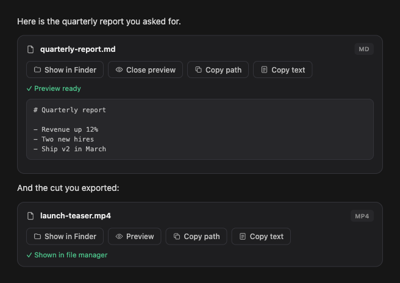

# file-actions — a Hermes plugin

**Show in Finder · Preview · Copy path · Copy text**, right under every file the agent hands you.



When a Hermes agent delivers a local file (`MEDIA:/path/to/file`), the desktop app shows a
generic download card. This plugin replaces it with a small action island that does the four
things you actually want with a file on your own machine — without sending a chat turn, and
without pretending: every chip reports what really happened, or a clear reason why not.

- **Show in Finder / Explorer** — selects the file in the OS file manager.
- **Preview** — images and text files inline in the chat; other types open in their default app.
- **Copy path** / **Copy text** — to the clipboard.

It works in both surfaces:

| Surface | How "Show in Finder" runs |
|---|---|
| Hermes desktop app (Electron) | native `ctx.os.revealPath` |
| Browser Webapp (`hermes webapp`, also over a tunnel) | this package's backend route, executed on the machine that serves the page |

## Install

```bash
hermes plugins install AbdullahPesteli/hermes-file-actions
hermes plugins enable file-actions
```

Then:

1. restart the gateway once (a running gateway keeps its old hook registry and API routes);
2. in the desktop app open *Capabilities → Plugins*, click **Rescan**, and switch
   **File actions** on — the desktop half of a package ships off by default.

## What is in the package

One folder, three parts — the [unified package layout](https://hermes-agent.nousresearch.com/docs/developer-guide/desktop-plugin-sdk#one-package-both-sdks):

```
plugin.yaml              agent half manifest
__init__.py              transform_llm_output hook: MEDIA: lines → ::file-actions islands
desktop/plugin.js        the island (React, plugin SDK only — no build step)
dashboard/plugin_api.py  /api/plugins/file-actions/{reveal,open,exists} for the Webapp
```

**The hook** rewrites the assistant's final text once per turn, before it is stored:

- non-media files lose the download card and get an island (`.html` also gets a live `::preview`);
- images, audio and video keep their inline player and get an island underneath;
- stray `MEDIA:` tokens in prose, code fences or dead paths are defused to `MEDIA :` so they
  don't spawn ghost cards;
- messaging platforms (Telegram, Slack, Discord, …) are left untouched — they deliver files natively;
- it is idempotent and fail-open: any error leaves the reply exactly as the model wrote it.

You can also write the directive yourself in any reply:

```
::file-actions{path="/absolute/path/to/file" label="Optional display name"}
```

`::finder-reveal{…}` is accepted as a legacy alias.

## Security

The backend routes sit behind the same sign-in as every other `/api` route of the dashboard /
Webapp. They only ever *reveal* or *open* an existing absolute path with the OS file manager
(`open -R`, `explorer /select,`, `xdg-open`); they never read, write, move or delete anything.
If you expose your Webapp publicly, anyone who can sign in can make your machine open a
Finder window — the same trust you already give them over the agent itself.

`hermes plugins validate` passes with one review note: Preview and Copy text read the file
through the host's file bridge (`window.hermesDesktop.readFileText` / `readFileDataUrl`), the
same reader the app's own attachment cards use. The SDK's `ctx.files` only reaches folders the
user granted to the plugin, and an agent can deliver a file from anywhere, so there is no SDK
door for it yet. Reveal and clipboard go through `ctx.os` and `ctx.rest` only.

## Language

The island follows the app language, then your system language, then falls back to English.
Bundled: English, Turkish. Adding a language is one block in `STRINGS` at the top of
`desktop/plugin.js` — PRs welcome.

## Development

```bash
git clone https://github.com/AbdullahPesteli/hermes-file-actions ~/src/hermes-file-actions
ln -s ~/src/hermes-file-actions ~/.hermes/plugins/file-actions   # linked: saves hot-reload
hermes plugins enable file-actions

# tests
uv run --no-project --with pytest --with fastapi --with httpx python -m pytest -q tests
bun test tests/plugin.test.js
hermes plugins validate .
```

Ideas that would make good first contributions:

- render Markdown in the preview instead of showing raw source;
- PDF and audio/video preview inside the island;
- an "Open with…" chip;
- more languages.

## License

MIT
